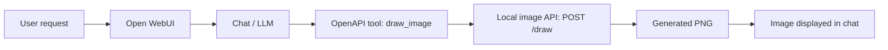
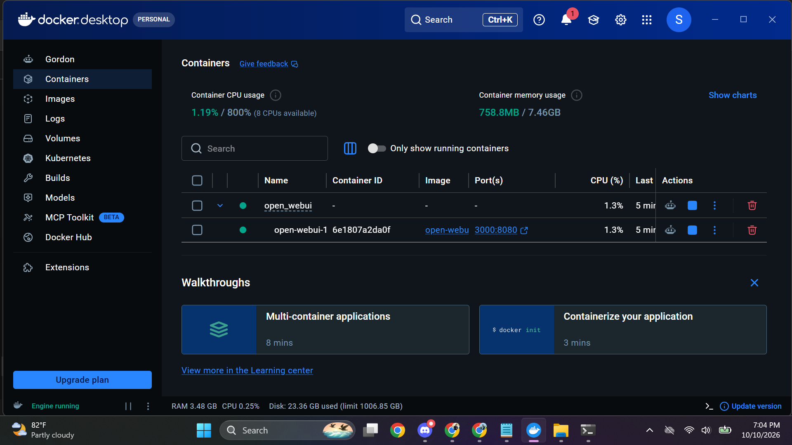
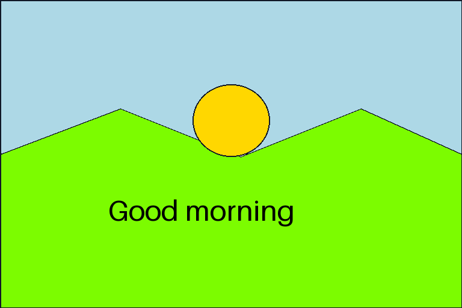

# Open WebUI + Drawing Studio

Generate PNG drawings from a chat request using **Open WebUI, Docker, and an authenticated OpenAPI tool**. The project includes a repeatable setup script, a separate drawing service, and tests.

## How it works

**User → Open WebUI → Chat/LLM → MCP or OpenAPI Tool → Image API → Generated Image**

This project implements the **OpenAPI** option. The image API is a local Pillow renderer in the same service as the tool; it creates drawings and diagrams without a paid image-generation provider. MCP and photorealistic text-to-image generation are not implemented.



The LLM translates the request into shapes and text. Open WebUI executes the tool call with its saved API key. The image API renders the drawing and returns a signed image URL plus Markdown for the model to include in its answer.

## 1. Run with Docker

**Prerequisites:** Windows PowerShell, Git, Docker Desktop running Linux containers, and a chat-model provider that supports tool calling. Ports **3000** and **8001** must be free. Python is installed inside the containers.

```powershell
git clone https://github.com/Sakif-rahman/Open_WebUI.git
cd Open_WebUI
powershell -NoProfile -ExecutionPolicy Bypass -File scripts/setup.ps1
```

Setup generates local secrets, builds the drawing service, starts both containers, registers the tool, and waits for healthy services. It preserves existing accounts and settings. Running it again updates the same tool connection.

Open **http://localhost:3000** and create your administrator account on a fresh installation. Under **Admin Settings → Connections**, add your chat provider's URL and API key, then select a tool-capable model. The Docker stack does not include a language model; the verified example uses Groq with `openai/gpt-oss-20b`.

## Docker 


## 2. Generate an image

Enable **Drawing Studio** in the chat composer's **Integrations / Tools** menu, then send:

> Use Drawing Studio to draw a sunrise over green hills with a yellow sun and the words Good morning. Display the image returned by the tool.

The tool supports rectangles, ellipses, lines, polygons, and text. It returns `image_url`, `markdown`, dimensions, and an expiration time.



## 3. Tool connection and authorization

[app.py](drawing_tool/app.py) defines the `draw_image` operation and its OpenAPI schema. [register_tool.py](scripts/register_tool.py) saves the following connection in Open WebUI automatically:

| Setting | Value |
| --- | --- |
| Protocol | OpenAPI |
| Tool server URL, inside Docker | `http://drawing-tool:8000` |
| Schema path | `openapi.json` |
| Image-generation endpoint | `POST /draw` |
| Authorization | `Authorization: Bearer <DRAWING_API_KEY>` |
| Browser image origin | `http://localhost:8001` |

The setup script creates a random **256-bit API key** in `.env.drawing` and supplies it to both services. Schema discovery and image generation reject missing or incorrect keys. Browser images use signed links that expire after **seven days**.

`.env.open-webui` stores the Open WebUI session secret; `.env.drawing` stores tool settings. Both files are ignored by Git. See [.env.example](.env.example) for variable names. Chat-provider credentials are configured separately in Open WebUI.

Use the Docker service name for backend calls and localhost for browser access. Both published ports bind to the local machine. For remote hosting, configure HTTPS and set `DRAWING_PUBLIC_URL` to the browser-accessible image origin.

## 4. File structure

```text
Open_WebUI/
├── compose.yaml                  # Docker services, health checks and volumes
├── .env.example                  # Documented settings; no real secrets
├── drawing_tool/
│   ├── app.py                    # OpenAPI endpoint, authorization and PNG rendering
│   ├── Dockerfile                # Production and test images
│   ├── requirements.txt          # Pinned service dependencies
│   ├── requirements-dev.txt      # Test dependencies
│   └── tests/test_app.py         # Authentication, rendering and validation tests
├── scripts/
│   ├── setup.ps1                 # Build, start and connect the services
│   ├── register_tool.py          # Persistent Open WebUI tool registration
│   └── smoke_test.py             # Discover and execute the connected tool
├── docs/                         # Requirements, verification and example images
└── main.py, routers/, models/...  # Original Open WebUI backend snapshot
```

Docker builds the drawing service from this repository and runs a pinned published Open WebUI image. The original backend snapshot is not mounted into that container.

## 5. Verify and maintain

Run from the repository root:

```powershell
docker compose ps

docker build --target test -t open-webui-drawing:test drawing_tool
docker run --rm open-webui-drawing:test

Get-Content -Raw scripts/smoke_test.py | docker compose exec -T open-webui python -
```

The eight unit tests check authorization, PNG output, input limits, signed links, and storage behavior. The smoke test discovers and invokes the tool through Open WebUI's installed executor, then downloads and validates the image. See the [verification record](docs/verification.md) and [task requirements](docs/requirements.md).

After editing the drawing service, rerun `scripts/setup.ps1` to rebuild it. Use `docker compose logs --tail 100 drawing-tool open-webui` for troubleshooting. `docker compose down` stops the stack while retaining data and images in named volumes; adding `-v` deletes those volumes.
